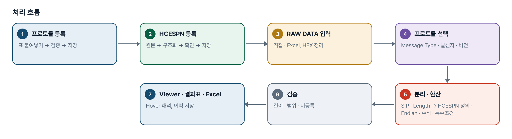
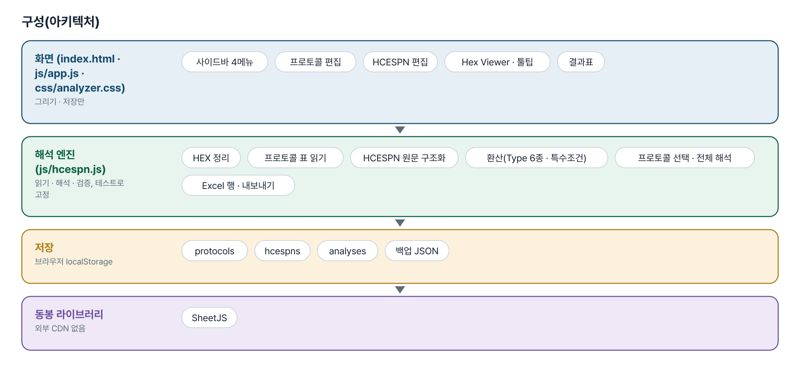
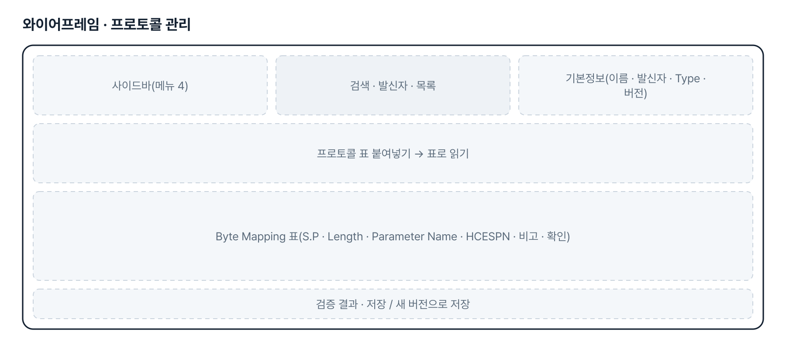
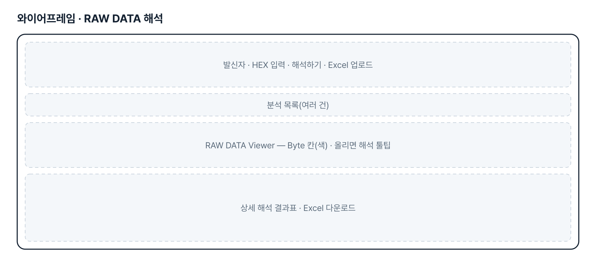
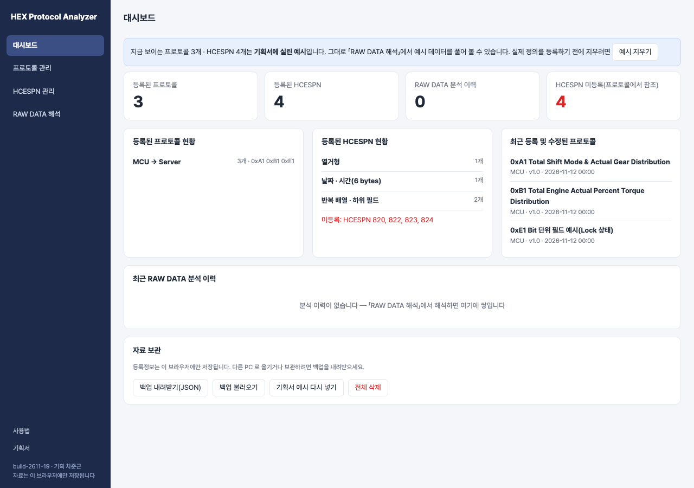

# HEX Protocol Analyzer · Bit 단위 필드 — 프로젝트 기획서 v1.0

- 기획: 차준근 · 작성일 2026-11-13 · 생성형 AI 업무자동화 전문가과정 · 2차수 프로젝트 19
- 바로 쓰기: https://build-2611-19.jobability.co.kr/
- 워드 판: `docs/기획서/build-2611-19_차준근_HEXProtocolAnalyzerBit단위필드_기획서_v1.0.docx`

## 개요

통신 프로토콜 표와 HCESPN 정의를 등록해 두면 16진수 RAW DATA 를 Byte 별로 자동 해석하는 도구(09번)에, 한 Byte 안의 Bit 몇 개로 정의된 필드(「52.1 / 2 bits」)를 등록 · 검증 · 추출 · 해석하는 기능을 더한 판입니다. Byte 필드와 Bit 필드를 한 프로토콜에 함께 둘 수 있습니다.

### 배경 · 현재 업무
- 09번(HEX Protocol Analyzer v2.0)은 프로토콜 필드를 Byte 단위로만 정의할 수 있었습니다.
- 실제 프로토콜에는 한 Byte 를 Bit 몇 개씩 나눠 쓰는 필드가 있습니다(예: Byte 52 의 Bit 1–2 = ESL Mode, Bit 3–4 = Lock Mode, Bit 5–8 = Lock Level).
- 기획자의 추가 요청(패들릿 2026-11-13)을 09번은 그대로 두고 새 번호 19 로 만들었습니다.

### 목표
- Byte 단위 필드와 Bit 단위 필드를 한 프로토콜에서 함께 등록합니다.
- 「52.1」「2 bits」 표기를 Byte · Bit 위치로 정확히 읽고, 겹침은 실제 Bit 범위로 검증합니다.
- Bit 번호 기준(Bit 1 = LSB / MSB)을 프로토콜마다 명시하고, 정해지지 않으면 추정하지 않습니다.
- 추출한 값에 HCESPN 의 열거값 · 환산식을 적용하고, 정의가 없으면 RAW 값만 보여 줍니다.

## 요구사항과 구현

| 기획서 요구 | 구현 |
|---|---|
| Byte 필드와 Bit 필드를 한 프로토콜에 함께 등록 | 줄마다 Byte 위치(sp)와 시작 Bit(bit) · Bit 길이(bits)를 따로 저장. Bit 가 없는 줄은 기존 Byte 필드 그대로 |
| 표 붙여넣기에서 52.1 · 2 bits · 1 byte · 6 bytes 인식 | spRange · lenUnit — 「52.1」은 Byte 52 의 Bit 1, 길이는 bit/byte 단위를 구분. 어긋난 표기(시작 Bit 없음 · 단위 불일치 · Bit 9)는 고치지 않고 줄마다 알림 |
| 같은 Byte 에 여러 필드 — 겹침은 실제 Bit 범위로 | validateProtocol 이 모든 필드를 Bit 구간으로 바꿔 겹침을 본다(Bit 끼리, Byte 필드와 Bit 필드 사이). 비어 있는 Bit 는 알림 |
| Bit 번호 기준을 프로토콜별로 명시, 불명확하면 추정 금지 | 프로토콜에 「Bit 번호 기준」(Bit 1 = LSB / MSB). Bit 필드가 있는데 고르지 않으면 저장할 수 없고, 해석도 하지 않고 오류로 알림 |
| 추출 뒤 HCESPN 열거값 · 환산식 · 특수조건 적용, 정의 없으면 RAW 만 | extractBits 로 꺼낸 값에 열거 · 수치 · 수식 형식의 HCESPN 을 적용. 미등록이면 추출 RAW 만. Byte 기준 특수조건은 Bit 필드에 적용하지 않고 알림. 날짜 · 배열 형식은 Bit 필드에 쓸 수 없음(오류) |
| 결과표에 Byte 위치 · Bit 범위 · 길이와 단위 · 원본 Byte HEX · 추출 RAW · 해석값 | 상세 해석 결과표에 「Bit 범위」 열, Length 에 단위, RAW HEX = 원본 Byte, Decimal Value = 추출 RAW. 엑셀에도 같은 열 |
| Byte Viewer — 한 Byte 에 여러 필드면 Hover 에 모두 표시, Bit 범위 확인 | 그 Byte 에 걸린 필드를 모두 보여 주고, 필드마다 8칸 Bit 그림에서 해당 범위를 강조. 여러 필드가 든 Byte 는 점선 테두리 |
| Byte 경계를 넘는 Bit 필드의 지원 여부를 명확히 | 지원하지 않음 — 한 Byte 안(시작 Bit + 길이 ≤ 8)만. 넘으면 붙여넣기 · 검증 · 저장 단계에서 오류로 안내 |
| 기존 Byte 단위 프로토콜 · 분석 이력 호환 | Byte 필드의 읽기 · 검증 · 해석 규칙은 09번 그대로(기존 시험 통과). 19번은 저장 공간이 따로라 09번 자료를 건드리지 않음 |
| 검증 예시 — Bit 1 = LSB, 0xB6 → 2 · 1 · 11, 0xA5 → 5 | 테스트에 고정. 예시 프로토콜(E1 B6 A5)로 화면에서도 확인 |
| 메뉴 4개 — 대시보드 · 프로토콜 관리 · HCESPN 관리 · RAW DATA 해석 | 왼쪽 사이드바 4개 메뉴. 대시보드에 프로토콜 · HCESPN 현황, 미등록 HCESPN, 최근 분석 이력, 최근 수정 프로토콜 |
| 통신 주체(발신자 · 수신자) | 발신자 MCU · RMCU · 인증장치 + 직접 추가, 수신자 기본 Server |
| 프로토콜 표 복사 · 붙여넣기 등록 | 탭 구분(엑셀) · 마크다운 · 「S.P: …」 글 꼴을 읽어 S.P · Length · Parameter Name · HCESPN · 비고 추출 → 미리보기 표에서 수정 → 저장. 비고 열 없어도 됨 |
| 자동 검증 | 필수 열 누락 · S.P 겹침 · 빈 구간 · S.P 범위와 Length 불일치(고치지 않고 알림) · Message Type 자동 추출 · HCESPN 등록 여부 · 중복 등록 |
| Message Type 별 프로토콜 · 버전 · 누적 저장 | 발신자 + Message Type + 버전 단위로 저장. 「새 버전으로 저장」 시 이전 버전 보관, 이전 버전으로 재해석 |
| HCESPN 등록 — 원문 붙여넣기 → 자동 구조화 → 확인 → 저장 | 번호 · 이름 · Data Length · Byte 별 항목 · Resolution · Offset · 유효범위 · Endianness · 특수조건을 찾아 칸에 넣고, 확인 뒤 저장 |

## 주요 기능

- **Bit 단위 필드** — 「52.1 / 2 bits」처럼 한 Byte 안의 Bit 몇 개를 필드로 등록하고 해석합니다.
- **Bit 범위 검증** — 같은 Byte 의 필드가 겹치는지 실제 Bit 범위로 확인하고, 비어 있는 Bit 를 알려 줍니다.
- **Bit 번호 기준** — Bit 1 이 LSB 인지 MSB 인지 프로토콜마다 정합니다. 정하지 않으면 해석하지 않습니다.
- **대시보드** — 등록 현황, 미등록 HCESPN, 최근 분석 이력 · 다시 해석, 백업.
- **프로토콜 관리** — 표 붙여넣기 등록, Byte Mapping 편집, 자동 검증, 버전 보관.
- **HCESPN 관리** — 원문 자동 구조화, Type · 하위 필드 · 환산식 · 특수조건, 버전.

## 처리 흐름(파이프라인)

1. **프로토콜 등록** — 표 붙여넣기 → 검증 → 저장
2. **HCESPN 등록** — 원문 → 구조화 → 확인 → 저장
3. **RAW DATA 입력** — 직접 · Excel, HEX 정리
4. **프로토콜 선택** — Message Type · 발신자 · 버전
5. **분리 · 환산** — S.P · Length → HCESPN 정의 · Endian · 수식 · 특수조건
6. **검증** — 길이 · 범위 · 미등록
7. **Viewer · 결과표 · Excel** — Hover 해석, 이력 저장

## 구성(아키텍처)

- **화면 (index.html · js/app.js · css/analyzer.css)** — 사이드바 4메뉴 · 프로토콜 편집 · HCESPN 편집 · Hex Viewer · 툴팁 · 결과표
- **해석 엔진 (js/hcespn.js)** — HEX 정리 · 프로토콜 표 읽기 · HCESPN 원문 구조화 · 환산(Type 6종 · 특수조건) · 프로토콜 선택 · 전체 해석 · Excel 행 · 내보내기
- **저장** — protocols · hcespns · analyses · 백업 JSON
- **동봉 라이브러리** — SheetJS

## 화면 구성(와이어프레임)

## 규칙 · 판정 기준

- 「52.1」은 소수가 아니라 Byte 52 의 Bit 1 입니다. Byte 위치와 Bit 위치를 따로 저장합니다.
- Bit 필드는 한 Byte 안(시작 Bit + 길이 − 1 ≤ 8)에서만 정의합니다. Byte 경계를 넘으면 오류입니다.
- Bit 1 = LSB: 값 = (Byte >> (시작 Bit − 1)) & (2^길이 − 1). Bit 1 = MSB: 값 = (Byte >> (9 − 시작 Bit − 길이)) & (2^길이 − 1).
- Bit 번호 기준이 정해지지 않으면 추출하지 않습니다(추정 금지).
- 겹침은 Bit 구간으로 봅니다 — Byte 필드는 그 Byte 의 Bit 전부를 차지합니다.
- HCESPN 정의가 없으면 추출한 RAW 값만 보여 주고 뜻을 만들지 않습니다.
- Byte 기준으로 적힌 HCESPN 특수조건은 Bit 필드에 적용하지 않습니다(알림).
- Start Position 은 1 부터 셉니다. Message Type 은 첫 Byte 입니다.
- HEX 는 공백 · 줄바꿈 · 쉼표 · 0x 를 걷고 대문자로 만듭니다. 16진수가 아닌 글자나 홀수 자릿수가 있으면 해석하지 않고 위치를 알립니다.
- 프로토콜은 Message Type(+ 발신자)으로 찾습니다. 버전이 여럿이면 가장 높은 버전으로 풀고 고르라고 알립니다. 보관된 버전은 자동 선택에서 뺍니다.
- 다중 Byte 수치는 Endianness 대로 읽습니다(Little = 앞 Byte 가 하위). 3C 00 00 00 → 60.
- 선형 환산 Physical = RAW × Resolution + Offset. 유효범위 밖이면 값은 보여 주되 「확인」으로 표시합니다.
- 날짜 · 시간(6 bytes): Year = 2000 + RAW, Month 1~12 · Day 1~31 · Hour 0~23 · Minute · Second 0~59. 범위 밖이거나 없는 날짜면 날짜로 환산하지 않습니다. 1A 0B 04 0D 1E 2D → 2026-11-04 13:30:45.
- 반복 배열은 하위 필드의 Byte 구간마다 따로 환산합니다. 필드에 비운 Resolution · Offset · Unit 은 HCESPN 의 값을 씁니다.
- 특수조건은 적용 범위(하위 필드마다 / 전체)를 정한 것만 적용합니다. 「확인 필요」는 적용하지 않고 알립니다.
- 사용자 정의 수식은 RAW · RES · OFFSET 과 사칙연산 · 괄호만 씁니다. 오류면 값을 만들지 않습니다.
- 프로토콜보다 짧으면 읽을 수 있는 항목까지만 풀고, 길면 초과 Byte 를 미정의로 둡니다. HCESPN 미등록 · 길이 불일치 항목은 RAW HEX 만 보여 줍니다.
- S.P 범위와 Length 가 어긋난 표는 고치지 않고 알립니다.

## 검증

- 계산 규칙 테스트 98개 · 화면 연기 테스트 56개 통과
- 해석 규칙 98개 — 09번의 72개 + Bit 필드 26개(위치 · 길이 읽기, 요청서 검증 예시 0xB6 → 2 · 1 · 11 · 0xA5 → 5, LSB/MSB, 기준 없음, 경계 넘음, 겹침, 열거 · 환산 적용, 미등록, Byte 지도, 엑셀 열, 기존 프로토콜 호환).
- 화면 56개 — 09번의 흐름 + Bit 결과표 · Viewer 의 여러 필드 표시 · Hover 의 Bit 그림 · 표 붙여넣기 · 기준 선택 · 겹침/경계 오류 · 53 bytes 해석.

## 이번 판에서 하지 않는 것

- Byte 경계를 넘는 Bit 필드(예: Bit 7 부터 4 bits)는 지원하지 않습니다. 필요한 경우 두 필드로 나눠 정의해야 합니다.
- HCESPN 820 · 822 · 823 · 824 의 뜻은 받지 못해 등록하지 않았습니다 — 예시에서는 추출한 RAW 값만 나옵니다. 「HCESPN 관리」에서 열거값을 등록하면 뜻이 붙습니다.
- 날짜 · 배열 형식의 HCESPN 은 Bit 필드에 쓸 수 없습니다.
- 자료는 이 브라우저에만 저장됩니다. 09번에 등록해 둔 자료는 자동으로 넘어오지 않습니다(09번에서 백업 → 19번에서 불러오기).

## 다음 단계

- 기획자 확인 — Bit 번호 기준과 Byte 경계 규칙이 실제 사양과 맞는지
- HCESPN 820~824 열거값 등록
- Byte 경계를 넘는 Bit 필드가 실제로 있으면 조합 규칙(상위 · 하위 Byte 순서) 정의

## 버전 이력

- **v1.0** (2026-11-13) — 09번 HEX Protocol Analyzer v2.0 을 바탕으로 Bit 단위 필드 추가 — 등록 · 표 붙여넣기 · Bit 범위 검증 · Bit 번호 기준 · 추출 · HCESPN 적용 · 결과표 · Byte Viewer · 엑셀
